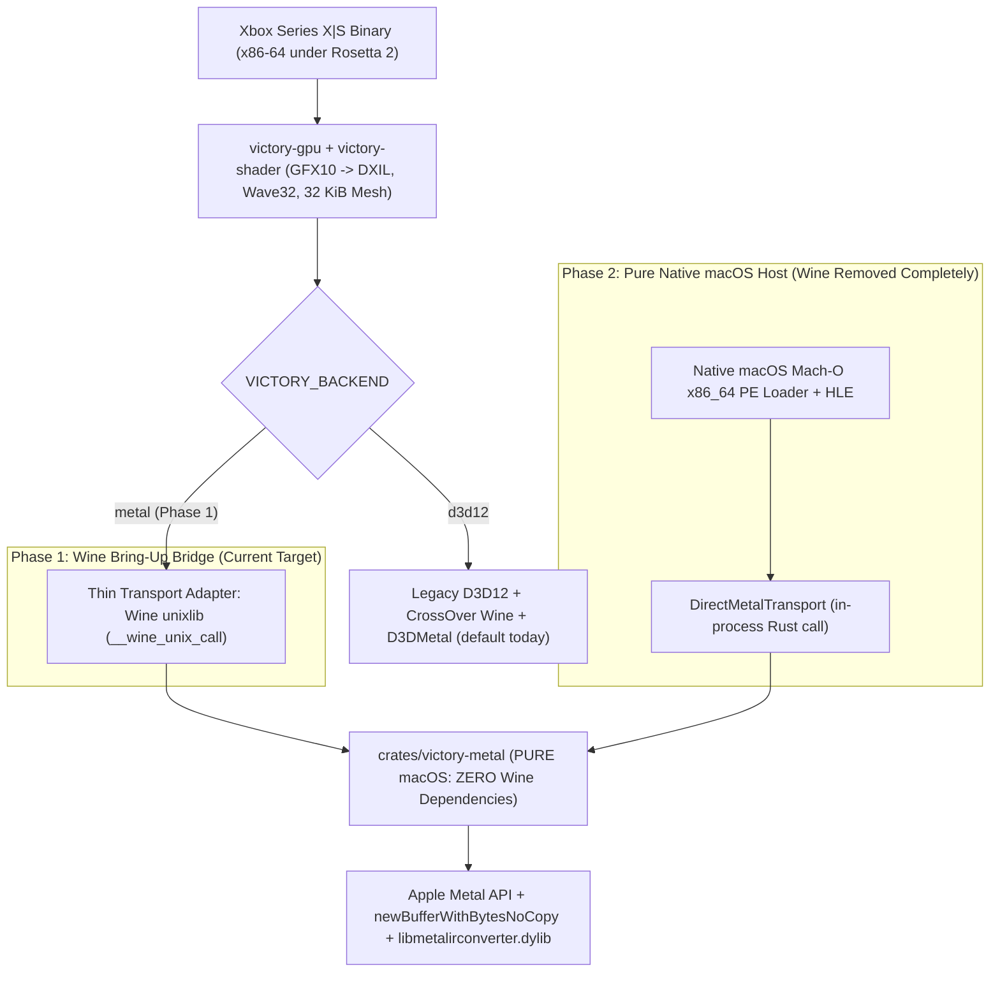

<p align="center"></p>

<h1 align="center">VIctory-Metal</h1>

<p align="center">
<strong>Experimental direct Apple Metal backend for <a href="https://github.com/pragyaangaur/VIctory-macOS">VIctory-macOS</a> &amp; <a href="https://github.com/Marvisak/VIctory">VIctory</a></strong><br>
Replacing D3DMetal with true zero-copy Apple Silicon Unified Memory (<code>newBufferWithBytesNoCopy</code> + <code>libmetalirconverter.dylib</code>),<br>
architected from day one so <strong>Wine can eventually be removed completely</strong>.
</p>

<p align="center">


</p>

> [!WARNING]
> **HIGHLY EXPERIMENTAL / NOT PLAYABLE YET.**
> This repository is an active R&amp;D effort to build a direct native Metal backend and decouple VIctory from CrossOver Wine + D3DMetal.
>
> - **It does NOT make GTA VI playable today.** Even with our current `mac-turbo` optimizations under D3DMetal, world frames on an **Apple M4 Max** measure **~494–585 ms (~1.7–2.0 fps)**.
> - **Native Metal is under active construction (Milestone M0–M1).** The full frame loop still runs on D3DMetal (`VICTORY_BACKEND=d3d12`, default) while the new `crates/victory-metal` backend (`VICTORY_BACKEND=metal`) is brought up piece by piece.
> - **Zero game assets are included or ever will be.** You must own your own Xbox Series X|S copy of the game. Every commit is checked by `cargo xtask policy`.

---

## Why Native Metal?

On Windows with AMD/PC D3D12, forks like [`VIctory-7900XTX`](https://github.com/avatarmanz/VIctory-7900XTX) reach **16–22 fps** largely because desktop D3D12 allows `ID3D12Device3::OpenExistingHeapFromAddress` — letting the GPU read Xbox unified memory directly with zero copies.

On macOS via **Wine + D3DMetal**, we hit a structural wall (`crates/victory-gpu/src/alias.rs`):

1. **D3DMetal refuses `OpenExistingHeapFromAddress*`.** Without zero-copy heaps, VIctory must maintain shadow D3D12 buffers, arm `VirtualProtect` write-watch page guards (`watch.rs`), field Rosetta write faults, copy **~250 MB/frame** (`copies: 70–98 ms`), and spend **~200 ms/frame** inside Wine D3D12 thunks / D3DMetal translation (`preparing`), plus `~18 ms/frame` scanning for `copying back`.
2. **Apple Silicon already *is* unified memory.** Metal natively supports `[MTLDevice newBufferWithBytesNoCopy:length:options:MTLResourceStorageModeShared deallocator:nil]` directly over page-aligned host allocations.
3. **Apple already ships DXIL → `.metallib`.** `victory-shader` compiles Xbox GFX10 shaders to DXIL (handling Metal hardware constraints such as Wave32 halves and the 32 KiB mesh-output limit), and Apple's `libmetalirconverter.dylib` compiles that DXIL directly into native `MTLLibrary` bitcode with **no D3D12 or D3DMetal API layer in between**.

---

## Wine-Free Endgame Architecture

`crates/victory-metal` is built with **strict separation from Wine and Windows**: zero Wine headers, zero `windows-sys` crates, and a clean backend trait (`MetalTransport`) paired with an `extern "C"` ABI (`libvictory_metal.dylib` / `rlib`).



Why this matters:
- **During bring-up (Phase 1)**, CrossOver Wine keeps running the Windows PE loader and Xbox HLE stubs so we can test real game shaders and frames incrementally without rewriting the OS loader first.
- **Once Metal rendering works (Phase 2 / M5)**, Wine is only a replaceable transport wrapper around `victory-metal`: swapping `victory-loader` / `victory-hle` to a native macOS Mach-O `x86_64` Rosetta host lets the exact same `victory-metal` engine run **with zero Wine and zero D3DMetal**.

---

## Current Status & Verified Results

### Native Metal Milestones Verified So Far

- **Milestone M0 — Host Zero-Copy & IRConverter PoC (`tools/macos/metal-poc/build-and-run.sh`): PASS**
  Tested directly under Rosetta 2 (`x86_64`) on **Apple M4 Max** (`unified=1`, `maxThreadsPerGroup=1024`):
  - **Zero-copy compute**: `posix_memalign(16384)` -> `newBufferWithBytesNoCopy` -> Metal compute kernel -> direct host read (`ptr=0x7fe848018000 len=65536 verified=1024 dwords host[0]=10 host[1023]=3079`, **0 `memcpy`**).
  - **IRConverter**: `dlopen(libmetalirconverter.dylib)` -> converted a real cached DXIL compute shader (`dxil_bytes=4288 stage=8 metallib_bytes=6748 functions=[main]`) to a runnable `MTLLibrary`.
- **Milestone M1 (Foundation) — `crates/victory-metal` & `VICTORY_BACKEND` Seam**:
  - Added pure-Rust `crates/victory-metal` (`rlib` + `cdylib`) with `VmStatus`/`VmDeviceInfo` C ABI, `MetalTransport` trait, `DirectMetalTransport` (`MTLDevice` + `newBufferWithBytesNoCopy` + MSL compute dispatch), `libmetalirconverter.dylib` loader (`x86_64`), and real Apple Silicon Metal unit tests.
  - Added `VICTORY_BACKEND=d3d12|metal` selection seam in `crates/victory-gpu/src/backend.rs`.

### Measured D3DMetal Baseline Progression (Apple M4 Max, World Gameplay)

This fork starts from `pragyaangaur/VIctory-macOS` (`main` @ `bf99e728`) plus local improvements on top:

| Run | Configuration | Frame Time (FPS) | Preparing / Copies | GPU Time | Refused >32 KiB Mesh / Dropped Indirects |
| --- | --- | --- | --- | --- | --- |
| `v0` | Older baseline | ~7,000 ms (~0.14 fps) | — | — | World unusable |
| `v2` | Rebased base + `VICTORY_AMBIENT` + `VICTORY_BVH_NO_HIT=1` (`1920x1080`) | 629–645 ms (1.6 fps) | 332–338 ms | 274–289 ms | 207–239 dropped without pipeline |
| `v3` | Series X `1280x720` + `ATOMIC_UMAX=1` + `ActivateRays` skip + thin LTO | **494–508 ms (2.0 fps)** | 266–286 ms (`copies 70–78 ms / ~196 MB`) | 189–215 ms | **46** refused mesh, **111** untranslated CS (~270 indirect/frame) |
| `v4` | `--console series-s` + `ntdll` patch + `PORT_DESCRIPTORS=1` | 1,019–1,292 ms (0.8–1.0 fps) | 696–889 ms (`copies 688–1,134 ms`) | 184–253 ms | Intro ran at 30 fps, but Series S blew up texture traffic (`6,913` textures / 5.05 GB) |
| `v5` | Series X `1280x720` + `render scale 0.5` + `PORT_DESCRIPTORS=1` + Metal mesh-align fix | **544–585 ms (1.7–1.8 fps)** | 286–332 ms (`copies 80–98 ms / 253–264 MB`) | 234–251 ms | Refused mesh **halved (46 -> 25)**, dropped indirects **cut 62% (270 -> 101/frame)** |

Included baseline additions above `VIctory-macOS`:
- **Metal-aligned mesh output linking trigger** (`crates/victory-gpu/src/pipeline.rs`): catches pipelines whose Metal-padded output exceeds 32,768 bytes (`46 -> 25` refused pipelines, `-62%` dropped indirects).
- **Title descriptor-store hooks** (`VICTORY_PORT_DESCRIPTORS=1`, ported from `VIctory-7900XTX`): fast slot updates (`~0.33 ms/frame`, `0` draw-table misses).
- **Experimental shader/lighting knobs**: `VICTORY_AMBIENT` indirect floor (adapted from `VIctory-Belobug-AMD`) and opt-in `VICTORY_BVH_NO_HIT=1` + `CS_ScreenProbes_ActivateRays` skip.

---

## Roadmap

Full technical details, hardware constraints, verified symbol tables, and LLM handoff context live in [docs/ROADMAP-METAL-NATIVE.md](docs/ROADMAP-METAL-NATIVE.md).

| Milestone | Scope | Status |
| --- | --- | --- |
| **M0** | Host PoC: `newBufferWithBytesNoCopy` compute + `libmetalirconverter.dylib` DXIL -> `MTLLibrary` under `x86_64` | **Done (verified on M4 Max)** |
| **M1** | Wine-decoupled `victory-metal` crate + `VICTORY_BACKEND` seam -> Wine unixlib bridge + `CAMetalLayer` clear window | **In Progress (crate & tests ready; Wine bridge next)** |
| **M2** | Zero-copy title memory registration + IRConverter root signatures (`IRRootSignatureCreateFromDescriptor`) + compute dispatch | Planned |
| **M3** | `MTLTexture` cache, RTV/DSV passes, `MTLMeshRenderPipelineDescriptor`, `executeIndirect` + argument buffers | Planned |
| **M4** | `MTLSharedEvent` synchronization + `MTLBinaryArchive` pipeline warmup + world FPS benchmark vs D3DMetal | Planned |
| **M5** | **Wine-free native macOS `x86_64` host** (replace Wine PE loader / Win32 thunks with Mach-O host + `DirectMetalTransport`) | Long-term endgame |

---

## Building & Running Tests

Requirements: Apple Silicon Mac (M1+), macOS 15+, Rust toolchain (`rustup`), Xcode Command Line Tools (`clang` + Metal/Foundation SDKs). Cross-compiling the Windows/Wine targets also uses `x86_64-pc-windows-gnullvm` + `llvm-mingw` (`./setup.sh` sets this up from [docs/macos.md](docs/macos.md)).

```bash
# Run strict asset & text-smuggling policy check (must always pass before commits)
cargo xtask policy

# Run host macOS unit & Metal tests (including zero-copy Metal compute on your GPU!)
cargo test --workspace
cargo test -p victory-metal -- --nocapture

# Run the standalone M0 Rosetta x86_64 PoC (requires GPTK/D3DMetal libmetalirconverter.dylib installed)
tools/macos/metal-poc/build-and-run.sh

# Cross-check Windows/Wine workspace build & clippy
cargo clippy --target x86_64-pc-windows-gnullvm --workspace --all-targets
```

> [!NOTE]
> For D3DMetal runs (`VICTORY_BACKEND=d3d12`, still the default), you still need CrossOver Wine + Apple Game Porting Toolkit (`setup.sh`) and a folder containing your own Xbox Series X|S copy pointed to by `victory.toml` (`victory.example.toml`). Keep `victory.toml` untracked and never commit game files.

---

## Strict Asset Policy

This repository contains **zero proprietary game files, shaders, binaries, keys, or captures**. `cargo xtask policy` (`xtask/src/policy.rs`) enforces an allowlist of small text/source files (`<= 512 KiB`, no binary headers, no long hex/base64 runs). Contributions must keep `cargo xtask policy` green and keep `crates/victory-shader/src/emit/lower.rs <= 524,288` bytes.

---

## Acknowledgements & Licence

Built directly upon the work of:
- **[VIctory](https://github.com/Marvisak/VIctory)** by **Marvisak** (the core loader, console runtime, GPU translation layer, and RDNA2/GFX10-to-DXIL shader recompiler).
- **[VIctory-macOS](https://github.com/pragyaangaur/VIctory-macOS)** by **Pragyaan Gaur** and contributors (bringing VIctory to macOS, Wine/Rosetta memory fixes, Wave32 lowering, and 32 KiB mesh linking).
- **[VIctory-7900XTX](https://github.com/avatarmanz/VIctory-7900XTX)** (`AvatarManz`) and **[VIctory-Belobug-AMD](https://github.com/Belobug/VIctory-Belobug-AMD)** (`Belobug`) for descriptor-porting and ambient lighting experiments.
- **CodeWeavers / Wine** and **Apple Game Porting Toolkit / Metal Shader Converter**.

Licensed under the **[GNU General Public License v3.0 or later](LICENSE)** (`GPL-3.0-or-later`), matching upstream VIctory. Not affiliated with or endorsed by Rockstar Games, Take-Two Interactive, Microsoft, or Apple.
